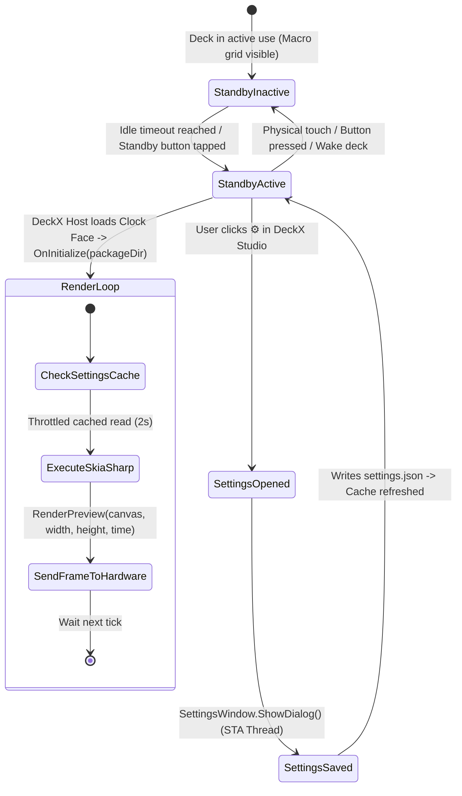

# DX8K Standby Clock Face Architecture & Developer Deep Dive

> **Target Platform:** DeckX Control Studio (.NET 8 / SkiaSharp 2D Graphics / DX8K Hardware Deck)  
> **Package / Library:** `DeckX.Core` (v1.1.1+)  
> **Template:** `DX8K.ClockFace.SampleTemplate`  
> **Target Display:** DX8K Screensaver / Standby Display Surface  
> **Distribution Format:** `.deckxclock`

---

## 📑 Table of Contents
1. [Overview: What is a DeckX Clock Face?](#1-overview-what-is-a-deckx-clock-face)
2. [Standby Lifecycle & State Machine](#2-standby-lifecycle--state-machine)
3. [Package Structure Anatomy (`.deckxclock`)](#3-package-structure-anatomy-deckxclock)
4. [Deep Dive: Project Configuration & Auto-Packer (`.csproj`)](#4-deep-dive-project-configuration--auto-packer-csproj)
5. [Deep Dive: The Clock Manifest (`clock.json`)](#5-deep-dive-the-clock-manifest-clockjson)
6. [Deep Dive: The `IDeckXClockFace` Interface](#6-deep-dive-the-ideckxclockface-interface)
7. [SkiaSharp Rendering Engine (`RenderPreview`)](#7-skiasharp-rendering-engine-renderpreview)
   - [OLED Deep-Dark Aesthetics & Corner Ticks](#oled-deep-dark-aesthetics--corner-ticks)
   - [Central Clock & Measured Text Positioning](#central-clock--measured-text-positioning)
   - [Dynamic Seconds Indicator & AM/PM Badges](#dynamic-seconds-indicator--ampm-badges)
   - [Top Capsule Weather Badge](#top-capsule-weather-badge)
8. [High-Performance Settings Caching](#8-high-performance-settings-caching)
   - [Why You Must Never Call `File.ReadAllText` in the Render Loop](#why-you-must-never-call-filereadalltext-in-the-render-loop)
   - [The 2-Second Throttle Cache Pattern](#the-2-second-throttle-cache-pattern)
9. [Integrated GUI Settings Dialog (`SettingsWindow.cs`)](#9-integrated-gui-settings-dialog-settingswindowcs)
   - [STA Thread Spawning](#sta-thread-spawning)
   - [Dark-Themed WinForms Architecture](#dark-themed-winforms-architecture)
   - [Atomic JSON Serialization](#atomic-json-serialization)
10. [Step-by-Step: Building Your Own Clock Face](#10-step-by-step-building-your-own-clock-face)
11. [Troubleshooting & Verification](#11-troubleshooting--verification)

---

## 1. Overview: What is a DeckX Clock Face?

When a DeckX hardware device (such as the **DX8K Control Pad**) is idle or placed into **Standby Mode**, the display switches from macro buttons to a full-screen screensaver known as a **Clock Face**.

A Clock Face plugin is a single C# DLL compiled into a self-contained `.deckxclock` package. It provides:
- **Real-Time Standby Rendering:** Vector graphics drawn using **SkiaSharp** at crisp resolutions.
- **Integrated Weather & Telemetry:** Displays current time, date, local weather status, temperature, and custom metrics.
- **Embedded Settings Window:** When a user clicks the Settings (⚙) gear icon on your card in the DeckX Control Studio Gallery, your DLL launches its own native configuration window.

```
   ┌────────────────────────────────────────────────────────┐
   │                  PHYSICAL DX8K DECK                    │
   │                                                        │
   │       ┌─ 28°C Clear  •  COLOMBO ─────────┐             │
   │                                                        │
   │                  14:32:05                              │
   │                                                        │
   │            Sunday, October 18, 2026                    │
   │                                                        │
   └───────────────────────────▲────────────────────────────┘
                               │ USB Serial Packet Stream
   ┌───────────────────────────▼────────────────────────────┐
   │                 DECKX CONTROL STUDIO                   │
   │              (Screensaver Standby Host)                │
   │                                                        │
   │   ┌────────────────────────────────────────────────┐   │
   │   │             Clock Face Plugin Host             │   │
   │   │  - Loads *.deckxclock DLLs                     │   │
   │   │  - Fires RenderPreview() once per second       │   │
   │   │  - Invokes OpenSettings() on gear icon click   │   │
   │   └───────────────────────▲────────────────────────┘   │
   └───────────────────────────┼────────────────────────────┘
                               │ In-Process Assembly Boundary
   ┌───────────────────────────▼────────────────────────────┐
   │            DX8K.ClockFace.SampleTemplate               │
   │                                                        │
   │  • SampleClockFace.cs      (IDeckXClockFace)           │
   │  • SettingsWindow.cs       (Dark WinForms Dialog)      │
   │  • settings.json           (User Config State)         │
   │  • clock.json              (Package Manifest)          │
   └────────────────────────────────────────────────────────┘
```

---

## 2. Standby Lifecycle & State Machine



---

## 3. Package Structure Anatomy (`.deckxclock`)

A `.deckxclock` file is a ZIP archive containing everything required to render the clock face and manage its user settings:

```
DX8K.ClockFace.SampleTemplate/
│
├── DX8K.ClockFace.SampleTemplate.csproj   # MSBuild SDK project with auto-packager
├── clock.json                             # Package manifest (specifies DLL entry point & metadata)
├── settings.json                          # Default user configuration contract
├── preview.png                            # 16:9 thumbnail for the DeckX card gallery
├── SampleClockFace.cs                     # Main class implementing IDeckXClockFace & SkiaSharp HUD
├── SettingsWindow.cs                      # Self-contained dark WinForms GUI settings dialog
├── README.md                              # Quick-start summary
├── DEVELOPER_GUIDE.md                     # This deep-dive architecture document
├── DX8K_ClockFace_Developer_Guide.pdf     # Graphical reference guide
└── libs/
    └── DeckX.Core.dll                     # Standalone API contract reference
```

---

## 4. Deep Dive: Project Configuration & Auto-Packer (`.csproj`)

The project uses the `net8.0-windows` target framework with `<UseWindowsForms>true</UseWindowsForms>` so that the embedded `SettingsWindow` can render natively without requiring WPF or external UI dependencies:

```xml
<Project Sdk="Microsoft.NET.Sdk">
  <PropertyGroup>
    <TargetFramework>net8.0-windows</TargetFramework>
    <UseWindowsForms>true</UseWindowsForms>
    <ImplicitUsings>enable</ImplicitUsings>
    <Nullable>enable</Nullable>
    <CopyLocalLockFileAssemblies>true</CopyLocalLockFileAssemblies>
  </PropertyGroup>

  <!-- Dual-Resolution: References project in solution if present, or official NuGet package -->
  <ItemGroup Condition="Exists('..\..\DeckX.Core\DeckX.Core.csproj')">
    <ProjectReference Include="..\..\DeckX.Core\DeckX.Core.csproj">
      <Private>false</Private>
      <ExcludeAssets>runtime</ExcludeAssets>
      <PrivateAssets>all</PrivateAssets>
    </ProjectReference>
  </ItemGroup>

  <ItemGroup Condition="!Exists('..\..\DeckX.Core\DeckX.Core.csproj')">
    <PackageReference Include="DeckX.Core" Version="1.1.1">
      <PrivateAssets>all</PrivateAssets>
      <ExcludeAssets>runtime</ExcludeAssets>
    </PackageReference>
  </ItemGroup>
```

### Auto-Packer Target (`AutoPackageDeckXClock`)
Upon running `dotnet build -c Release` (or pressing `Ctrl + Shift + B` in VS Code):
1. Compiles the C# DLL: `DX8K.ClockFace.SampleTemplate.dll`.
2. Gathers `clock.json`, `settings.json`, `preview.png`, and the DLL into `bin\staging\`.
3. Compresses the directory into:
   ```
   releases/DX8K.ClockFace.SampleTemplate.deckxclock
   ```
4. **Instant Hot-Reload Deployment:** Automatically installs the package into:
   ```
   %APPDATA%\DeckX\devices\control_pad\dx8k\screensaver\clock_faces\com.dx8k.sample.clockface\
   ```
   Your updated clock face is immediately available in DeckX Control Studio without manual file copying!

---

## 5. Deep Dive: The Clock Manifest (`clock.json`)

```json
{
  "$schema": "https://deckx.app/schemas/clock-face.schema.json",
  "id": "com.dx8k.sample.clockface",
  "name": "Sample Standby Clock & Weather",
  "author": "DeckX Developer Community",
  "version": "1.0.0",
  "description": "Standalone clock & weather standby face implemented as a single C# DLL plugin with integrated Settings UI window.",
  "assembly": "DX8K.ClockFace.SampleTemplate.dll",
  "preview": "preview.png",
  "settings": true,
  "layout": "custom",
  "targetDevice": "DX8K",
  "resolution": {
    "width": 800,
    "height": 480
  },
  "tags": [ "clock", "weather", "plugin", "dll", "standby" ]
}
```

### Key Properties:
- **`id`**: Unique reverse-DNS identifier (e.g., `com.dx8k.sample.clockface`). Must match `IDeckXClockFace.Id`.
- **`assembly`**: The exact filename of the compiled output `.dll`.
- **`preview`**: Relative path to the 16:9 thumbnail shown in the gallery card.
- **`settings`**: When `true`, DeckX displays the ⚙ gear button on the card.
- **`targetDevice`**: Designates the intended hardware deck model (`DX8K`).

---

## 6. Deep Dive: The `IDeckXClockFace` Interface

Every Standby Clock Face must implement `IDeckXClockFace` from `DeckX.Core.Plugins`:

```csharp
public interface IDeckXClockFace
{
    string Id { get; }
    string Name { get; }
    string Author { get; }
    string Version { get; }
    string Description { get; }

    bool HasSettings { get; }

    void OnInitialize(string packageDirectory);
    void RenderPreview(SKCanvas canvas, int width, int height, DateTime currentTime);
    void OpenSettings();
    void OnShutdown();
}
```

### Method Responsibilities:
1. **`OnInitialize(string packageDirectory)`**:
   Called when DeckX loads the clock face. Stores the path to `settings.json` and loads initial user settings into memory.
2. **`RenderPreview(SKCanvas canvas, int width, int height, DateTime currentTime)`**:
   The heartbeat of the screensaver. Called once per second with the active display resolution and current local time.
3. **`OpenSettings()`**:
   Invoked when the user clicks the ⚙ Settings button in DeckX Control Studio. Spawns the custom settings dialog.
4. **`OnShutdown()`**:
   Fired when the user switches to a different clock face or closes DeckX. Use for disposing unmanaged resources or stopping timers.

---

## 7. SkiaSharp Rendering Engine (`RenderPreview`)

`RenderPreview` provides an empty `SKCanvas` with the specified `width` and `height`. 

### OLED Deep-Dark Aesthetics & Corner Ticks
To maximize contrast on physical LCD and OLED panels, start with deep blacks and subtle cyber accents:

```csharp
// 1. Deep OLED Background
canvas.Clear(new SKColor(8, 10, 16));

// 2. Corner Decorative Accent Ticks
using var tickPaint = new SKPaint
{
    Color = accentColor.WithAlpha(140),
    StrokeWidth = 2.0f,
    Style = SKPaintStyle.Stroke,
    IsAntialias = true
};
const float tickLen = 14f;
// Top-Left corner:
canvas.DrawLine(16, 16, 16 + tickLen, 16, tickPaint);
canvas.DrawLine(16, 16, 16, 16 + tickLen, tickPaint);
```

---

### Central Clock & Measured Text Positioning
Rather than hardcoding arbitrary coordinates, measure string dimensions using `paint.MeasureText(text)` to ensure perfect horizontal centering:

```csharp
bool is12H = _cachedClockFormat.Equals("12h", StringComparison.OrdinalIgnoreCase);
string timeFormat = is12H ? "hh:mm" : "HH:mm";
string timeStr = currentTime.ToString(timeFormat);

using var timePaint = new SKPaint
{
    Color = SKColors.White,
    TextSize = 92f,
    IsAntialias = true,
    FakeBoldText = true,
    TextAlign = SKTextAlign.Center
};

float centerY = height / 2.0f + 20f;
canvas.DrawText(timeStr, width / 2.0f, centerY, timePaint);
```

---

### Dynamic Seconds Indicator & AM/PM Badges
To place the seconds indicator `:ss` immediately to the right of the hour:minute text without overlapping:

```csharp
if (_cachedShowSeconds)
{
    using var secPaint = new SKPaint
    {
        Color = accentColor,
        TextSize = 22f,
        IsAntialias = true,
        FakeBoldText = true,
        TextAlign = SKTextAlign.Left
    };
    
    // Calculate the right edge of the centered time text:
    float textHalfWidth = timePaint.MeasureText(timeStr) / 2.0f;
    float secX = width / 2.0f + textHalfWidth + 6;
    float secY = centerY - 28;

    canvas.DrawText(currentTime.ToString(":ss"), secX, secY, secPaint);
}
```

---

### Top Capsule Weather Badge
To render a floating pill badge at the top:
```csharp
float badgeW = 260, badgeH = 28;
var badgeRect = new SKRoundRect(
    new SKRect(width / 2.0f - badgeW / 2.0f, 22, width / 2.0f + badgeW / 2.0f, 22 + badgeH), 
    14, 14
);

// Draw Background Pill
using var badgeBg = new SKPaint { Color = new SKColor(16, 20, 30), IsAntialias = true };
canvas.DrawRoundRect(badgeRect, badgeBg);

// Draw Subtle Accent Border
using var badgeBorder = new SKPaint 
{ 
    Color = accentColor.WithAlpha(100), 
    Style = SKPaintStyle.Stroke, 
    StrokeWidth = 1.2f, 
    IsAntialias = true 
};
canvas.DrawRoundRect(badgeRect, badgeBorder);

// Draw Centered Weather String
string weatherStr = $"28°C Clear  •  {_cachedCity.ToUpperInvariant()}";
canvas.DrawText(weatherStr, width / 2.0f, 40.5f, badgeTextPaint);
```

---

## 8. High-Performance Settings Caching

### Why You Must Never Call `File.ReadAllText` in the Render Loop
`RenderPreview` executes continuously (typically once per second or faster). If you read `settings.json` from the hard drive or SSD on every single tick:
- High disk I/O and battery drain on laptops.
- File lock contention if the Settings dialog attempts to save while the render loop is reading.
- Dropped frames and micro-stutters.

---

### The 2-Second Throttle Cache Pattern
`SampleClockFace.cs` implements an in-memory cache with a 2-second timestamp gate:

```csharp
private DateTime _lastSettingsCheck = DateTime.MinValue;

private void RefreshSettingsCache()
{
    if (string.IsNullOrEmpty(_packageDirectory)) return;

    // Check disk at most once every 2 seconds:
    if ((DateTime.UtcNow - _lastSettingsCheck).TotalSeconds < 2) return;
    _lastSettingsCheck = DateTime.UtcNow;

    try
    {
        string path = Path.Combine(_packageDirectory, "settings.json");
        if (File.Exists(path))
        {
            string json = File.ReadAllText(path);
            using var doc = JsonDocument.Parse(json);
            var root = doc.RootElement;
            
            if (root.TryGetProperty("city", out var c)) _cachedCity = c.GetString()!;
            if (root.TryGetProperty("accentColor", out var a)) _cachedAccentColor = a.GetString()!;
            // ... cached in private memory fields!
        }
    }
    catch { /* Ignore momentary file lock collisions */ }
}
```

---

## 9. Integrated GUI Settings Dialog (`SettingsWindow.cs`)

DeckX does not force developers into rigid, XML-based settings schemas. You can build any user interface you want inside `SettingsWindow.cs`.

### STA Thread Spawning
Because DeckX Control Studio runs on its own UI thread (Avalonia UI), any WinForms window must be spawned on a dedicated background thread initialized with the **Single-Threaded Apartment (STA)** model:

```csharp
public void OpenSettings()
{
    var thread = new Thread(() =>
    {
        try
        {
            SettingsWindow.ShowDialog(_packageDirectory);
        }
        catch (Exception ex)
        {
            Debug.WriteLine($"[ClockFace] Error showing settings: {ex.Message}");
        }
    });

    thread.SetApartmentState(ApartmentState.STA); // MANDATORY for WinForms!
    thread.IsBackground = true;
    thread.Start();
}
```

---

### Dark-Themed WinForms Architecture
`SettingsWindow.cs` configures a dark palette matching DeckX Studio:
- **Form Background:** `#101118` (Deep Charcoal)
- **Header Panel:** `#161822` (Dark Slate)
- **Inputs & Dropdowns:** `#1E202E` with white text
- **Accent Button:** `#00FFCC` (Neon Cyan) or customizable preset buttons

---

### Atomic JSON Serialization
When the user clicks **Save & Apply Changes**, the dialog serializes the updated fields back into `settings.json` using `System.Text.Json`:

```csharp
var jsonObject = new JsonObject
{
    ["city"] = cityBox.Text.Trim(),
    ["temperatureUnit"] = unitCombo.SelectedItem?.ToString() ?? "C",
    ["clockFormat"] = formatCombo.SelectedItem?.ToString() ?? "24h",
    ["showSeconds"] = secondsCheck.Checked,
    ["accentColor"] = activeAccentHex
};

string updatedJson = jsonObject.ToJsonString(new JsonSerializerOptions { WriteIndented = true });
File.WriteAllText(settingsPath, updatedJson);

form.Close();
```
Within 2 seconds, the `RefreshSettingsCache()` pattern picks up the new colors and parameters automatically!

---

## 10. Step-by-Step: Building Your Own Clock Face

### Step 1: Copy and Rename the Project
1. Copy the `DX8K.ClockFace.SampleTemplate` folder and rename it (e.g., `DX8K.ClockFace.RetroFlip`).
2. Rename `DX8K.ClockFace.SampleTemplate.csproj` to `DX8K.ClockFace.RetroFlip.csproj`.

### Step 2: Configure `clock.json`
Update:
- `"id"`: `"com.myusername.retroflip"`
- `"name"`: `"Retro Split-Flap Standby Clock"`
- `"assembly"`: `"DX8K.ClockFace.RetroFlip.dll"`

### Step 3: Implement Custom SkiaSharp Visuals
Open `SampleClockFace.cs` and rename the class to `RetroFlipClockFace`. In `RenderPreview`:
- Draw retro split-flap cards with horizontal center score lines.
- Or draw an analog dial with hour, minute, and second sweep needles using trigonometric angles (`Math.Cos`, `Math.Sin`).

### Step 4: Build and Verify
Run in your terminal:
```bash
dotnet build -c Release
```
The auto-packer generates:
```
releases/DX8K.ClockFace.RetroFlip.deckxclock
```
And immediately installs it into:
```
%APPDATA%\DeckX\devices\control_pad\dx8k\screensaver\clock_faces\com.myusername.retroflip\
```
Open **DeckX Control Studio**, go to **Standby Screensaver Gallery**, and select your new clock face!

---

## 11. Troubleshooting & Verification

| Issue | Cause | Solution |
| :--- | :--- | :--- |
| **Settings (⚙) button is missing in DeckX Gallery** | `HasSettings` is false or `"settings": false` in `clock.json`. | Ensure `public bool HasSettings => true;` in C# and `"settings": true` in `clock.json`. |
| **Settings dialog crashes on launch** | Thread apartment state is not STA. | Ensure `thread.SetApartmentState(ApartmentState.STA)` is called before `thread.Start()`. |
| **Settings changes don't take effect immediately** | File cache throttle or wrong directory. | Verify `packageDirectory` passed to `OnInitialize` matches the path where `settings.json` was saved. |
| **Clock text overflows on smaller displays** | Hardcoded text positions instead of proportional coordinates. | Use `timePaint.MeasureText(...)` and relative coordinate calculations (`width / 2.0f`, `height / 2.0f`). |
| **High disk activity during standby** | Reading `settings.json` on every frame tick. | Implement the 2-second throttle cache pattern shown in Section 8. |
