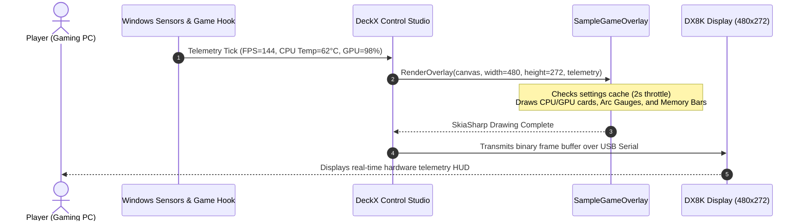

# DX8K Game Overlay & Telemetry HUD Architecture & Developer Deep Dive

> **Target Platform:** DeckX Control Studio (.NET 8 / SkiaSharp 2D Graphics / DX8K Hardware Deck)  
> **Package / Library:** `DeckX.Core` (v1.1.1+)  
> **Template:** `DX8K.GameOverlay.SampleTemplate`  
> **Target Display:** 480x272 4.3" DX8K Control Pad & Desktop Floating HUD  
> **Distribution Format:** `.deckxoverlay`

---

## 📑 Table of Contents
1. [Overview: What is a DeckX Game Overlay?](#1-overview-what-is-a-deckx-game-overlay)
2. [High-Level Architecture & Telemetry Pipeline](#2-high-level-architecture--telemetry-pipeline)
3. [Package Structure Anatomy (`.deckxoverlay`)](#3-package-structure-anatomy-deckxoverlay)
4. [Deep Dive: Project Configuration & Auto-Packer (`.csproj`)](#4-deep-dive-project-configuration--auto-packer-csproj)
5. [Deep Dive: The Overlay Manifest (`overlay.json`)](#5-deep-dive-the-overlay-manifest-overlayjson)
6. [Deep Dive: The `IDeckXGameOverlay` Interface](#6-deep-dive-the-ideckxgameoverlay-interface)
7. [The `GameOverlayTelemetryData` Contract](#7-the-gameoverlaytelemetrydata-contract)
8. [SkiaSharp 480x272 Cyber HUD Layout & Card Architecture](#8-skiasharp-480x272-cyber-hud-layout--card-architecture)
   - [Top Status Bar (Game Name, FPS, Time)](#top-status-bar-game-name-fps-time)
   - [CPU Telemetry Card (Radial Arc Temp, Clocks, Fan)](#cpu-telemetry-card-radial-arc-temp-clocks-fan)
   - [GPU Telemetry Card (Thermals, Usage, Clocks)](#gpu-telemetry-card-thermals-usage-clocks)
   - [RAM & VRAM Memory Cards](#ram--vram-memory-cards)
9. [Reusable SkiaSharp HUD Rendering Helpers](#9-reusable-skiasharp-hud-rendering-helpers)
   - [Anti-Aliased Card Framing (`DrawCardFrame`)](#anti-aliased-card-framing-drawcardframe)
   - [Round-Capped Arc Temperature Gauge (`DrawArcGauge`)](#round-capped-arc-temperature-gauge-drawarcgauge)
   - [Stat Rows & Pill Progress Bars (`DrawProgressBar`)](#stat-rows--pill-progress-bars-drawprogressbar)
   - [Text Measurement & Ellipsis Truncation (`TruncateText`)](#text-measurement--ellipsis-truncation-truncatetext)
   - [Typeface Fallback Cascade (`GetTypeface`)](#typeface-fallback-cascade-gettypeface)
10. [Integrated Dark-Themed Settings UI (`SettingsWindow.cs`)](#10-integrated-dark-themed-settings-ui-settingswindowcs)
   - [STA Thread Apartment State Model](#sta-thread-apartment-state-model)
   - [Built-In 7 Cyberpunk Color Presets](#built-in-7-cyberpunk-color-presets)
   - [Sensor Card Toggles & Custom CPU/GPU Overrides](#sensor-card-toggles--custom-cpugpu-overrides)
   - [The `SettingsSaved` Event for Instant Hot-Reload](#the-settingssaved-event-for-instant-hot-reload)
11. [High-Performance Rendering & Memory Rules](#11-high-performance-rendering--memory-rules)
12. [Step-by-Step: Building Your Own Game Overlay](#12-step-by-step-building-your-own-game-overlay)
13. [Troubleshooting & Verification](#13-troubleshooting--verification)

---

## 1. Overview: What is a DeckX Game Overlay?

In **DeckX Control Studio**, a **Game Overlay** is a dedicated real-time telemetry HUD plugin designed to render on both:
1. **The Physical DX8K Hardware Screen:** Showing in-game FPS, thermals, clock speeds, and memory metrics right below your monitor.
2. **Desktop Floating HUDs:** Displayed on secondary PC monitors or streaming overlays.

Unlike generic monitoring apps that require complex web server configurations or external software like RivaTuner/HWiNFO, DeckX Game Overlays are **single-project C# DLLs** bundled into a self-contained `.deckxoverlay` package with an integrated GUI settings window.

```
   ┌────────────────────────────────────────────────────────┐
   │                  PHYSICAL DX8K DECK                    │
   │  CYBERPUNK 2077          144 FPS             04:32 PM  │
   │  ┌──────────────────────┐  ┌──────────────────────┐    │
   │  │ CPU  Ryzen 9 7950X   │  │ GPU  RTX 4090 OC     │    │
   │  │   ╭─╮ USAGE: 42% ─── │  │   ╭─╮ USAGE: 98% ─── │    │
   │  │  │62°│ CLOCK: 4.8GHz  │  │  │71°│ CLOCK: 2.7GHz  │    │
   │  │   ╰─╯ FAN:   1450RPM │  │   ╰─╯ FAN:   1800RPM │    │
   │  └──────────────────────┘  └──────────────────────┘    │
   │  ┌──────────────────────┐  ┌──────────────────────┐    │
   │  │ RAM  32 GB   64% ─── │  │ GPU VRAM  24GB 82% ─ │    │
   │  │ U: 20.4GB  F: 11.6GB │  │ U: 19.6GB  F:  4.4GB │    │
   │  └──────────────────────┘  └──────────────────────┘    │
   └───────────────────────────▲────────────────────────────┘
                               │ USB Serial Packet Stream
   ┌───────────────────────────▼────────────────────────────┐
   │                 DECKX CONTROL STUDIO                   │
   │              (Hardware Telemetry Host)                 │
   │                                                        │
   │   • Polls Hardware Sensors (LibreHardwareMonitor)      │
   │   • Tracks Active Foreground Game Window & FPS         │
   │   • Dispatches GameOverlayTelemetryData to Plugins     │
   │   • Encodes & Streams SkiaSharp Frame Buffers          │
   └───────────────────────────▲────────────────────────────┘
                               │ In-Process Assembly Boundary
   ┌───────────────────────────▼────────────────────────────┐
   │            DX8K.GameOverlay.SampleTemplate             │
   │                                                        │
   │  • SampleGameOverlay.cs   (IDeckXGameOverlay)          │
   │  • SettingsWindow.cs      (Dark WinForms Dialog)       │
   │  • settings.json          (User Theme & Sensor Config) │
   │  • overlay.json           (Package Manifest)           │
   └────────────────────────────────────────────────────────┘
```

---

## 2. High-Level Architecture & Telemetry Pipeline



---

## 3. Package Structure Anatomy (`.deckxoverlay`)

A `.deckxoverlay` file is a ZIP package containing the compiled entry assembly, package manifest, default configuration, and visual preview:

```
DX8K.GameOverlay.SampleTemplate/
│
├── DX8K.GameOverlay.SampleTemplate.csproj   # MSBuild SDK project with integrated auto-packer
├── overlay.json                             # Package manifest (ID, name, author, entry assembly)
├── settings.json                            # Default user configuration contract
├── preview.png                              # 16:9 thumbnail for the DeckX Studio Gallery
├── SampleGameOverlay.cs                     # Core plugin implementing IDeckXGameOverlay & SkiaSharp HUD
├── SettingsWindow.cs                        # Integrated dark WinForms GUI settings dialog
├── README.md                                # Quick-start summary
├── DEVELOPER_GUIDE.md                       # This deep-dive architecture document
├── DX8K_GameOverlay_Developer_Guide.pdf     # Graphical reference guide
└── libs/
    └── DeckX.Core.dll                       # Standalone API contract reference
```

---

## 4. Deep Dive: Project Configuration & Auto-Packer (`.csproj`)

The project targets `.net8.0-windows` with `<UseWindowsForms>true</UseWindowsForms>` for the embedded settings dialog, while referencing `SkiaSharp` and `DeckX.Core`:

```xml
<Project Sdk="Microsoft.NET.Sdk">
  <PropertyGroup>
    <TargetFramework>net8.0-windows</TargetFramework>
    <UseWindowsForms>true</UseWindowsForms>
    <ImplicitUsings>enable</ImplicitUsings>
    <Nullable>enable</Nullable>
    <CopyLocalLockFileAssemblies>true</CopyLocalLockFileAssemblies>
  </PropertyGroup>

  <ItemGroup Condition="!Exists('..\..\DeckX.Core\DeckX.Core.csproj')">
    <PackageReference Include="DeckX.Core" Version="1.1.1">
      <PrivateAssets>all</PrivateAssets>
      <ExcludeAssets>runtime</ExcludeAssets>
    </PackageReference>
  </ItemGroup>

  <ItemGroup>
    <PackageReference Include="SkiaSharp" Version="2.88.8" />
  </ItemGroup>
```

### Auto-Packer Target (`AutoPackageDeckXOverlay`)
Upon running `dotnet build -c Release`:
1. Compiles your C# code into `DX8K.GameOverlay.SampleTemplate.dll`.
2. Packages `overlay.json`, `settings.json`, `preview.png`, and the DLL into `bin\staging\`.
3. Compresses the directory into:
   ```
   releases/DX8K.GameOverlay.SampleTemplate.deckxoverlay
   ```
4. **Instant Hot-Reload Deployment:** Deploys directly into:
   - `%APPDATA%\DeckX\devices\control_pad\dx8k\game_overlays\com.dx8k.sample.gameoverlay\`
   - `%APPDATA%\DeckX\DX8K\game_overlays\`

---

## 5. Deep Dive: The Overlay Manifest (`overlay.json`)

```json
{
  "$schema": "https://deckx.app/schemas/game-overlay.schema.json",
  "id": "com.dx8k.sample.gameoverlay",
  "name": "Cyber Neon Telemetry HUD",
  "author": "DeckX Developer Community",
  "version": "1.0.0",
  "description": "High-performance gaming & hardware telemetry HUD plugin with real-time FPS, CPU/GPU thermal metrics, and integrated settings dialog.",
  "assembly": "DX8K.GameOverlay.SampleTemplate.dll",
  "preview": "preview.png",
  "settings": true,
  "layout": "custom",
  "targetDevice": "DX8K",
  "resolution": {
    "width": 480,
    "height": 272
  },
  "tags": [ "game", "overlay", "hud", "telemetry", "fps", "plugin", "dll" ]
}
```

### Key Properties:
- **`id`**: Unique reverse-DNS identifier (e.g., `com.dx8k.sample.gameoverlay`). Must match `IDeckXGameOverlay.Id`.
- **`assembly`**: The exact output filename of your compiled DLL.
- **`settings`**: When `true`, DeckX displays the ⚙ gear button on the card.
- **`resolution`**: The native drawing canvas dimension (`480x272`).

---

## 6. Deep Dive: The `IDeckXGameOverlay` Interface

```csharp
public interface IDeckXGameOverlay
{
    string Id { get; }
    string Name { get; }
    string Author { get; }
    string Version { get; }
    string Description { get; }

    bool HasSettings { get; }
    event Action? SettingsSaved;

    void OnInitialize(string packageDirectory);
    void RenderOverlay(SKCanvas canvas, int width, int height, GameOverlayTelemetryData telemetry);
    void OpenSettings();
    void OnShutdown();
}
```

### Method Contract:
- **`OnInitialize(string packageDirectory)`**: Fired when DeckX loads the overlay DLL. Store `_packageDirectory` and load initial settings.
- **`RenderOverlay(...)`**: Receives an empty `SKCanvas` along with the live `GameOverlayTelemetryData` object on every telemetry tick.
- **`OpenSettings()`**: Opens the developer's custom configuration dialog.
- **`SettingsSaved` event**: Trigger this event when the user clicks Save in the settings dialog to force DeckX to re-render the overlay immediately with the new colors/parameters.

---

## 7. The `GameOverlayTelemetryData` Contract

DeckX Control Studio automatically collects telemetry from host hardware sensors and injects it into `RenderOverlay`:

| Telemetry Property | Type | Description |
| :--- | :--- | :--- |
| `telemetry.ActiveGameName` | `string` | Title of the currently focused 3D game window (e.g. `"Cyberpunk 2077"`). |
| `telemetry.Fps` | `int` | Real-time frames per second (e.g. `144`). |
| `telemetry.TimeText` | `string` | Formatted current local time string (e.g. `"4:32 PM"`). |
| `telemetry.CpuName` | `string` | Auto-detected processor model (e.g. `"AMD Ryzen 9 7950X"`). |
| `telemetry.CpuUsagePercent`| `int` | Overall CPU utilization (`0` to `100%`). |
| `telemetry.CpuTempC` | `int` | CPU package temperature in Celsius (`°C`). |
| `telemetry.CpuClockGhz` | `float` | Active CPU core clock frequency in GHz (e.g. `4.85f`). |
| `telemetry.CpuFanRpm` | `int` | CPU cooler fan speed in RPM (e.g. `1450`). |
| `telemetry.GpuName` | `string` | Auto-detected graphics card model (e.g. `"NVIDIA GeForce RTX 4090"`). |
| `telemetry.GpuUsagePercent`| `int` | GPU core load percentage (`0` to `100%`). |
| `telemetry.GpuTempC` | `int` | GPU junction / core temperature in Celsius (`°C`). |
| `telemetry.GpuClockMhz` | `float` | Active GPU core clock speed in MHz (e.g. `2750f`). |
| `telemetry.GpuFanRpm` | `int` | GPU cooler fan speed in RPM (e.g. `1800`). |
| `telemetry.RamName` | `string` | Installed RAM profile name. |
| `telemetry.RamUsagePercent`| `int` | Total system memory usage percentage (`0` to `100%`). |
| `telemetry.RamUsedGb` | `float` | Memory consumed by system & active game in GB (e.g. `18.4f`). |
| `telemetry.RamFreeGb` | `float` | Available free physical memory in GB (e.g. `13.6f`). |
| `telemetry.VramUsagePercent`| `int`| Dedicated video memory load percentage (`0` to `100%`). |
| `telemetry.VramUsedGb` | `float` | Video memory allocated in GB (e.g. `16.2f`). |
| `telemetry.VramFreeGb` | `float` | Free video memory buffer in GB (e.g. `7.8f`). |

---

## 8. SkiaSharp 480x272 Cyber HUD Layout & Card Architecture

The template subdivides the 480x272 display into a high-density, balanced layout:

```
  0,0 ───────────────────────────────────────────────────────────── 480,0
   │  [ACTIVE GAME NAME]              [144 FPS]          [TIME]   │ (Top Bar: H=28)
  0,28 ──────────────────────────────────────────────────────────── 480,28
   │ ┌───────────────────────────┐  ┌───────────────────────────┐ │
   │ │ CPU  Ryzen 9 7950X        │  │ GPU  RTX 4090 OC          │ │ (Top Cards:
   │ │   ╭─╮ USAGE: 42% [====  ] │  │   ╭─╮ USAGE: 98% [======] │ │  H=144)
   │ │  │62°│ CLOCK: 4.85 GHz─── │  │  │71°│ CLOCK: 2750 MHz── │ │
   │ │   ╰─╯ FAN:   1450 RPM───  │  │   ╰─╯ FAN:   1800 RPM───  │ │
   │ └───────────────────────────┘  └───────────────────────────┘ │
  0,176 ─────────────────────────────────────────────────────────── 480,176
   │ ┌───────────────────────────┐  ┌───────────────────────────┐ │
   │ │ RAM  32 GB        64%     │  │ GPU VRAM          82%     │ │ (Bottom Cards:
   │ │ [==================     ] │  │ [======================  ] │ │  H=90)
   │ │ U: 20.4 GB   F: 11.6 GB   │  │ U: 19.6 GB   F:  4.4 GB   │ │
   │ └───────────────────────────┘  └───────────────────────────┘ │
  0,272 ─────────────────────────────────────────────────────────── 480,272
```

### Proportional Coordinate Reference:
- **Display Bounds:** `Width = 480`, `Height = 272`
- **Top Status Bar:** `Y = 0` to `27`
- **Left Column Cards:** `X = 6`, `Width = 231`
- **Right Column Cards:** `X = 243`, `Width = 231`
- **Top Row Height:** `H = 144` (`Y = 28` to `172`)
- **Bottom Row Height:** `H = 90` (`Y = 176` to `266`)

---

## 9. Reusable SkiaSharp HUD Rendering Helpers

### Anti-Aliased Card Framing (`DrawCardFrame`)
Creates modern, cybernetic container cards with rounded corners and subtle border strokes:

```csharp
private static void DrawCardFrame(SKCanvas canvas, float x, float y, float w, float h, SKColor bg, SKColor border)
{
    var fillRect = new SKRoundRect(new SKRect(x, y, x + w, y + h), 10, 10);
    using var fillPaint = new SKPaint { Color = bg, Style = SKPaintStyle.Fill, IsAntialias = true };
    canvas.DrawRoundRect(fillRect, fillPaint);

    var strokeRect = new SKRoundRect(new SKRect(x + 0.5f, y + 0.5f, x + w - 0.5f, y + h - 0.5f), 9.5f, 9.5f);
    using var strokePaint = new SKPaint { Color = border, Style = SKPaintStyle.Stroke, StrokeWidth = 1.2f, IsAntialias = true };
    canvas.DrawRoundRect(strokeRect, strokePaint);
}
```

---

### Round-Capped Arc Temperature Gauge (`DrawArcGauge`)
Draws a compact circular dial with a 270-degree background track and sweeping value arc:

```csharp
float size = 62;
float strokeW = 5f;
float halfStroke = strokeW / 2f;
var oval = new SKRect(arcX + halfStroke, arcY + halfStroke, arcX + size - halfStroke, arcY + size - halfStroke);
float cx = arcX + (size / 2f);
float cy = arcY + (size / 2f);

// 1. Draw 270-degree background track
using var trackPaint = new SKPaint
{
    Color = trackColor,
    Style = SKPaintStyle.Stroke,
    StrokeWidth = strokeW,
    StrokeCap = SKStrokeCap.Round,
    IsAntialias = true
};
canvas.DrawArc(oval, 135f, 270f, false, trackPaint);

// 2. Draw active temperature sweep
float maxTemp = string.Equals(unit, "F", StringComparison.OrdinalIgnoreCase) ? 212f : 100f;
float sweepAngle = (Math.Clamp(tempVal, 0, maxTemp) / maxTemp) * 270f;
if (sweepAngle > 0.5f)
{
    using var valPaint = new SKPaint
    {
        Color = accentColor,
        Style = SKPaintStyle.Stroke,
        StrokeWidth = strokeW,
        StrokeCap = SKStrokeCap.Round,
        IsAntialias = true
    };
    canvas.DrawArc(oval, 135f, sweepAngle, false, valPaint);
}
```

---

### Stat Rows & Pill Progress Bars (`DrawProgressBar`)
```csharp
private static void DrawProgressBar(SKCanvas canvas, float x, float y, float w, float h, float pctVal, SKColor accent, SKColor track)
{
    float radius = h / 2f;
    var trackRect = new SKRoundRect(new SKRect(x, y, x + w, y + h), radius, radius);
    using var trackPaint = new SKPaint { Color = track, Style = SKPaintStyle.Fill, IsAntialias = true };
    canvas.DrawRoundRect(trackRect, trackPaint);

    float fillW = w * Math.Clamp(pctVal / 100f, 0f, 1f);
    if (fillW >= 1.5f)
    {
        var fillRect = new SKRoundRect(new SKRect(x, y, x + fillW, y + h), radius, radius);
        using var fillPaint = new SKPaint { Color = accent, Style = SKPaintStyle.Fill, IsAntialias = true };
        canvas.DrawRoundRect(fillRect, fillPaint);
    }
}
```

---

### Text Measurement & Ellipsis Truncation (`TruncateText`)
Hardware card titles must never bleed into neighboring cards. `TruncateText` truncates long game titles (e.g. `"The Witcher 3: Wild Hunt - Complete Edition"`) to fit exact pixel widths:

```csharp
private static string TruncateText(string text, float maxWidth, SKPaint paint)
{
    if (string.IsNullOrEmpty(text)) return string.Empty;
    if (paint.MeasureText(text) <= maxWidth) return text;

    string ellipsis = "...";
    float ellipsisW = paint.MeasureText(ellipsis);
    int len = text.Length;
    while (len > 1)
    {
        len--;
        if (paint.MeasureText(text.AsSpan(0, len)) + ellipsisW <= maxWidth)
        {
            return text.Substring(0, len) + ellipsis;
        }
    }
    return text;
}
```

---

### Typeface Fallback Cascade (`GetTypeface`)
To guarantee razor-sharp typography regardless of which fonts are installed on the user's PC:
```csharp
private static SKTypeface GetTypeface(bool bold)
{
    var weight = bold ? SKFontStyleWeight.Bold : SKFontStyleWeight.Normal;
    
    // 1. Preferred modern gaming font:
    var tf = SKTypeface.FromFamilyName("Montserrat", weight, SKFontStyleWidth.Normal, SKFontStyleSlant.Upright);
    if (tf != null && tf.FamilyName.Equals("Montserrat", StringComparison.OrdinalIgnoreCase)) return tf;

    // 2. Windows standard system font:
    tf = SKTypeface.FromFamilyName("Segoe UI", weight, SKFontStyleWidth.Normal, SKFontStyleSlant.Upright);
    if (tf != null && tf.FamilyName.Equals("Segoe UI", StringComparison.OrdinalIgnoreCase)) return tf;

    // 3. Fallback:
    return SKTypeface.FromFamilyName("Arial", weight, SKFontStyleWidth.Normal, SKFontStyleSlant.Upright) ?? SKTypeface.Default;
}
```

---

## 10. Integrated Dark-Themed Settings UI (`SettingsWindow.cs`)

### STA Thread Apartment State Model
Because the DeckX Control Studio host application runs on Avalonia UI, any Windows Forms dialog MUST be executed inside an STA thread:

```csharp
public void OpenSettings()
{
    var thread = new Thread(() =>
    {
        try
        {
            var result = SettingsWindow.ShowDialog(_packageDirectory);
            _lastSettingsCheck = DateTime.MinValue; // Invalidate cache
            RefreshSettingsCache();
            if (result == DialogResult.OK)
            {
                SettingsSaved?.Invoke(); // Immediate live redraw!
            }
        }
        catch (Exception ex)
        {
            Debug.WriteLine($"[Overlay] Error: {ex.Message}");
        }
    });

    thread.SetApartmentState(ApartmentState.STA); // MANDATORY!
    thread.IsBackground = true;
    thread.Start();
}
```

---

### Built-In 7 Cyberpunk Color Presets
The settings dialog includes one-click theme presets:

| Preset Name | Accent Color | Secondary Color | Card Background | Card Border |
| :--- | :--- | :--- | :--- | :--- |
| **Cyber Neon** | `#00F0FF` (Cyan) | `#3B82F6` (Blue) | `#10131D` | `#23293B` |
| **Stealth Dark** | `#FFFFFF` (White) | `#3B82F6` (Blue) | `#121216` | `#24242C` |
| **Arctic Glacier** | `#38BDF8` (Sky) | `#818CF8` (Indigo) | `#0C182E` | `#1A2F54` |
| **Ember Flame** | `#F97316` (Orange) | `#EF4444` (Red) | `#22120C` | `#3D1F16` |
| **Neon Synth** | `#EC4899` (Pink) | `#A855F7` (Purple) | `#240E1D` | `#421B35` |
| **Matrix Green** | `#10B981` (Emerald) | `#84CC16` (Lime) | `#0D2111` | `#183D20` |
| **Violet Night** | `#8B5CF6` (Violet) | `#3B82F6` (Blue) | `#161029` | `#2C2052` |

---

### Sensor Card Toggles & Custom CPU/GPU Overrides
Users can:
- Toggle individual cards on/off (`showFps`, `showCpu`, `showGpu`, `showRam`, `showVram`).
- Override the hardware model name (e.g., if a user wants to show `"Ryzen 9 7950X"` instead of the generic raw string `"AMD Ryzen 9 7950X 16-Core Processor"`).
- Toggle between Celsius (`°C`) and Fahrenheit (`°F`).

---

## 11. High-Performance Rendering & Memory Rules

1. **Zero Allocations on Hot Paths:**
   `RenderOverlay` can be called 10 to 60 times per second. Never allocate new `List<T>`, strings, or dictionaries inside `RenderOverlay`.
2. **Dispose Local `SKPaint` Instances:**
   Always wrap temporary `SKPaint` or `SKPath` instances in `using var` statements so native Skia unmanaged pointers are freed immediately.
3. **Use the 2-Second Settings Cache:**
   Never read `settings.json` directly inside `RenderOverlay`. Use the `RefreshSettingsCache()` throttle pattern demonstrated in `SampleGameOverlay.cs`.
4. **Notify via `SettingsSaved` Event:**
   Always invoke `SettingsSaved?.Invoke()` when the settings dialog closes so DeckX re-renders immediately without waiting for the next telemetry poll.

---

## 12. Step-by-Step: Building Your Own Game Overlay

### Step 1: Copy and Rename the Project
1. Copy `DX8K.GameOverlay.SampleTemplate` and rename to `DX8K.GameOverlay.SimRacing`.
2. Rename `DX8K.GameOverlay.SampleTemplate.csproj` to `DX8K.GameOverlay.SimRacing.csproj`.

### Step 2: Configure `overlay.json`
Update:
- `"id"`: `"com.myusername.simracing"`
- `"name"`: `"Forza / iRacing Telemetry HUD"`
- `"assembly"`: `"DX8K.GameOverlay.SimRacing.dll"`

### Step 3: Implement Your Custom SkiaSharp Visuals
In `SampleGameOverlay.cs`:
- Rename the class to `SimRacingOverlay`.
- Replace the card layout in `RenderOverlay` with a central Gear indicator (`"N"`, `"1"`, `"2"`...), RPM tachometer arc bar, speed in KM/H or MPH, and tire wear indicators.

### Step 4: Build and Deploy
```bash
dotnet build -c Release
```
The auto-packer builds:
```
releases/DX8K.GameOverlay.SimRacing.deckxoverlay
```
And deploys directly into:
```
%APPDATA%\DeckX\devices\control_pad\dx8k\game_overlays\com.myusername.simracing\
```
Open **DeckX Control Studio**, navigate to **Game Overlays & Telemetry**, and click **Apply**!

---

## 13. Troubleshooting & Verification

| Issue | Cause | Solution |
| :--- | :--- | :--- |
| **Overlay does not appear in DeckX Studio** | Manifest ID mismatch or invalid JSON. | Verify `overlay.json` exists in root and `"assembly"` matches compiled `.dll` name. |
| **Settings (⚙) button does nothing** | WinForms thread apartment state is not STA. | Ensure `thread.SetApartmentState(ApartmentState.STA)` is set before starting the thread. |
| **Telemetry numbers show 0 or blank** | Hardware sensor service is disabled or game not detected. | Ensure LibreHardwareMonitor is enabled in DeckX Control Studio settings. |
| **Text overflows outside cards** | Unconstrained strings without measurement. | Use `TruncateText(text, maxWidth, paint)` to measure text bounds and apply ellipsis. |
| **Micro-stutters during gaming** | Reading `settings.json` from disk inside `RenderOverlay`. | Implement the 2-second timestamp gate in `RefreshSettingsCache()`. |
