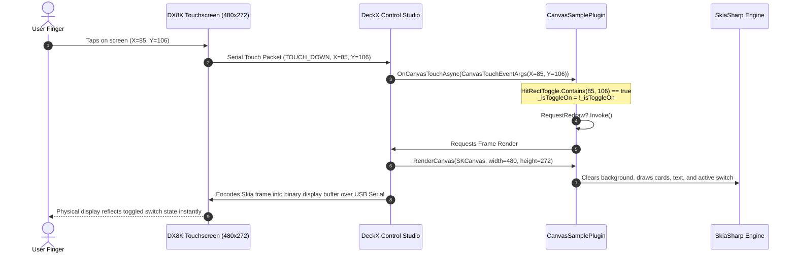

# DX8K Canvas Plugin Architecture & Developer Deep Dive

> **Target Platform:** DeckX Control Studio (.NET 8 / SkiaSharp 2D Graphics / DX8K Hardware Deck)  
> **Package / Library:** `DeckX.Core` (v1.1.1+)  
> **Template:** `DX8K.Plugin.CanvasSampleTemplate`  
> **Target Display:** 480x272 4.3" Capacitive Touch Display (DX8K Control Pad)

---

## 📑 Table of Contents
1. [What is a DeckX Canvas Plugin?](#1-what-is-a-deckx-canvas-plugin)
2. [Architectural Comparison: Button Plugin vs. Canvas Plugin](#2-architectural-comparison-button-plugin-vs-canvas-plugin)
3. [Hardware & Screen Specifications](#3-hardware--screen-specifications)
4. [Communication & Rendering Pipeline](#4-communication--rendering-pipeline)
5. [Project Structure Anatomy](#5-project-structure-anatomy)
6. [Deep Dive: Project Configuration & Auto-Packer (`.csproj`)](#6-deep-dive-project-configuration--auto-packer-csproj)
7. [Deep Dive: The Canvas Manifest (`plugin.json`)](#7-deep-dive-the-canvas-manifest-pluginjson)
8. [Deep Dive: Implementation (`CanvasSamplePlugin.cs`)](#8-deep-dive-implementation-canvassampleplugincs)
   - [The `IDeckXCanvasPlugin` Interface Contract](#the-ideckxcanvasplugin-interface-contract)
   - [Event-Driven vs. Continuous Streaming Mode](#event-driven-vs-continuous-streaming-mode)
   - [Zero-Allocation Touch Hit-Testing (`SKRect`)](#zero-allocation-touch-hit-testing-skrect)
   - [The 6 Interactive Widgets Demonstrated](#the-6-interactive-widgets-demonstrated)
9. [Mastering SkiaSharp 2D Rendering for DX8K](#9-mastering-skiasharp-2d-rendering-for-dx8k)
   - [Anti-Aliasing & Color Management](#anti-aliasing--color-management)
   - [Cards & Rounded Rectangles](#cards--rounded-rectangles)
   - [Radial Arc Gauges with `DrawArc`](#radial-arc-gauges-with-drawarc)
   - [Real-Time Sparkline Waveforms with `SKPath`](#real-time-sparkline-waveforms-with-skpath)
   - [Crisp Typography & Alignments](#crisp-typography--alignments)
10. [Critical Performance & Serial USB Rules](#10-critical-performance--serial-usb-rules)
11. [Step-by-Step: Creating Your Own Canvas Dashboard](#11-step-by-step-creating-your-own-canvas-dashboard)
12. [Troubleshooting & Verification](#12-troubleshooting--verification)

---

## 1. What is a DeckX Canvas Plugin?

In **DeckX Control Studio**, a standard plugin binds individual actions into predefined 8-button grid layouts. 

A **Canvas Plugin**, however, takes complete ownership of the **entire 480x272 physical hardware screen**. Instead of fitting into individual button tiles, you receive a raw **SkiaSharp `SKCanvas`** drawing surface and real-time **Capacitive Touch Coordinates `(X, Y)`** directly from the hardware screen.

This allows developers to build:
- **Comprehensive Hardware HUDs & Telemetry Dashboards** (CPU/GPU temps, memory, network sparklines).
- **Audio Mixers & Equalizers** (vertical volume faders, VU meters, mute toggles).
- **Smart Home Controllers** (radial thermostat dials, RGB color pickers, room lighting switches).
- **Sim-Racing & Flight Sim Instrument Clusters** (speedometers, gear indicators, telemetry curves).

---

## 2. Architectural Comparison: Button Plugin vs. Canvas Plugin

| Feature | 🔲 Button Plugin (`IDeckXPlugin`) | 🎨 Canvas Plugin (`IDeckXCanvasPlugin`) |
| :--- | :--- | :--- |
| **Display Area** | 8 individual button tiles in a 4x2 grid | Full-screen continuous 480x272 canvas |
| **Rendering API** | High-level properties (`SetTitle`, `SetBackgroundColor`, `SetBorder`, `SetIcon`) | Direct 2D vector graphics via **SkiaSharp** (`SKCanvas`, `SKPaint`, `DrawArc`, `DrawPath`) |
| **Input Handling** | Key tap event per button index (`1` to `8`) | Precise **Capacitive Touch Coordinates** `(e.X, e.Y)` with bounding-box hit testing |
| **Visual Freedom** | Constrained to button boxes | Unconstrained; draw custom cards, circular dials, smooth graphs, sliders, or animations |
| **Update Mechanism**| Two-way key updaters (`UpdatePowerKey`) | `RenderCanvas(...)` and `RequestRedraw?.Invoke()` |
| **Manifest Flag** | Standard plugin manifest | `"isCanvasPlugin": true` in `plugin.json` |

---

## 3. Hardware & Screen Specifications

```
  0,0 ────────────────────────────────────────── 480,0
   │                                               │
   │      DECKX DX8K CAPACITIVE TOUCH SURFACE      │
   │                                               │
   │    • Native Resolution: 480 x 272 pixels      │
   │    • Display Ratio: ~16:9 Landscape           │
   │    • Color Depth: 16-bit / 24-bit TrueColor   │
   │    • Touch Controller: Capacitive (Raw X, Y)  │
   │                                               │
  0,272 ──────────────────────────────────────── 480,272
```

- **Screen Width:** `480` pixels
- **Screen Height:** `272` pixels
- **Touch Coordinate Space:** `X` spans `0` (left) to `480` (right); `Y` spans `0` (top) to `272` (bottom).

---

## 4. Communication & Rendering Pipeline



---

## 5. Project Structure Anatomy

```
DX8K.Plugin.CanvasSampleTemplate/
│
├── DX8K.Plugin.CanvasSampleTemplate.csproj   # MSBuild SDK project with integrated auto-packer
├── plugin.json                               # Manifest with "isCanvasPlugin": true
├── CanvasSamplePlugin.cs                     # Core C# class implementing IDeckXCanvasPlugin
├── README.md                                 # Quick-start summary
├── DEVELOPER_GUIDE.md                        # This deep-dive architecture document
├── DX8K_CanvasPlugin_Developer_Guide.pdf     # Graphical reference guide
└── assets/                                   # (Optional) Bundled fonts, icons, or background PNGs
```

---

## 6. Deep Dive: Project Configuration & Auto-Packer (`.csproj`)

The project file uses the **Microsoft.NET.Sdk** targeting `.net8.0` and references `SkiaSharp` alongside `DeckX.Core`:

```xml
<Project Sdk="Microsoft.NET.Sdk">
  <PropertyGroup>
    <TargetFramework>net8.0</TargetFramework>
    <ImplicitUsings>enable</ImplicitUsings>
    <Nullable>enable</Nullable>
    <CopyLocalLockFileAssemblies>true</CopyLocalLockFileAssemblies>
  </PropertyGroup>

  <!-- Reference DeckX.Core for interfaces and SkiaSharp for 2D graphics -->
  <ItemGroup Condition="!Exists('..\..\DeckX.Core\DeckX.Core.csproj')">
    <PackageReference Include="DeckX.Core" Version="1.1.1">
      <PrivateAssets>all</PrivateAssets>
      <ExcludeAssets>runtime</ExcludeAssets>
    </PackageReference>
  </ItemGroup>

  <ItemGroup>
    <PackageReference Include="SkiaSharp" Version="2.88.8" />
  </ItemGroup>
```

### Integrated Auto-Packer (`AutoPackageDeckXPlugin`)
When you build the project (`dotnet build -c Release`):
1. Compiles the plugin into `DX8K.Plugin.CanvasSampleTemplate.dll`.
2. Packages `plugin.json` and the DLL into `releases/DX8K.Plugin.CanvasSampleTemplate.deckxplugin`.
3. Installs directly into `%APPDATA%\DeckX\Plugins\com.dx8k.canvas.sampletemplate\` for instant testing in DeckX Control Studio.

---

## 7. Deep Dive: The Canvas Manifest (`plugin.json`)

The manifest file explicitly informs DeckX that this is a **full-screen Canvas Plugin** using `"isCanvasPlugin": true`:

```json
{
  "id": "com.dx8k.canvas.sampletemplate",
  "name": "DX8K Canvas Plugin Template",
  "version": "1.0.0",
  "author": "DeckX Developer",
  "description": "Reference developer template for creating full-screen 480x272 interactive canvas dashboards.",
  "category": "Custom Dashboards",
  "categoryIcon": "M3 3h18v18H3V3zm16 16V5H5v14h14zM7 7h10v2H7V7zm0 4h10v2H7v-2zm0 4h7v2H7v-2z",
  "targetDevice": "DX8K",
  "supportedDevices": [ "DX8K" ],
  "assembly": "DX8K.Plugin.CanvasSampleTemplate.dll",
  "isCanvasPlugin": true,
  "actions": [
    {
      "id": "canvas_page:sample_dashboard",
      "actionType": "Plugin:CanvasPage",
      "title": "Sample Canvas Dashboard",
      "description": "Interactive reference canvas dashboard with widgets, dials, graphs, and buttons.",
      "iconGeometry": "M3 3h18v18H3V3zm16 16V5H5v14h14zM7 7h10v2H7V7zm0 4h10v2H7v-2zm0 4h7v2H7v-2z",
      "category": "Custom Dashboards"
    }
  ]
}
```

> [!IMPORTANT]
> The `"isCanvasPlugin": true` flag is mandatory. It tells the DeckX runtime engine to bypass the default 8-key button grid layout and render the plugin on the full hardware display buffer.

---

## 8. Deep Dive: Implementation (`CanvasSamplePlugin.cs`)

### The `IDeckXCanvasPlugin` Interface Contract

```csharp
public interface IDeckXCanvasPlugin : IDeckXPlugin
{
    int TargetFps { get; }
    bool NeedsContinuousStream { get; }
    event Action? RequestRedraw;

    void RenderCanvas(SKCanvas canvas, int width, int height);
    Task OnCanvasTouchAsync(CanvasTouchEventArgs e);
}
```

---

### Event-Driven vs. Continuous Streaming Mode

DeckX supports two rendering modes for Canvas plugins:

#### Mode 1: Event-Driven Rendering (`NeedsContinuousStream = false`) — **Recommended**
```csharp
public int TargetFps => 1;
public bool NeedsContinuousStream => false;
```
- In this mode, DeckX redraws the screen **only when a state change occurs** (e.g., user touches a button, or a background clock timer fires).
- When your state mutates, invoke the event:
  ```csharp
  _isToggleOn = !_isToggleOn;
  RequestRedraw?.Invoke(); // Notifies DeckX to render a fresh frame immediately!
  ```
- **Why it matters:** Drastically reduces CPU/GPU overhead and eliminates USB Serial bandwidth saturation.

#### Mode 2: Continuous Streaming (`NeedsContinuousStream = true`)
```csharp
public int TargetFps => 15; // 15 frames per second
public bool NeedsContinuousStream => true;
```
- Useful for high-speed VU meters, particle effects, or 60 FPS animated waveforms.
- The engine will call `RenderCanvas(...)` continuously at `TargetFps`.

---

### Zero-Allocation Touch Hit-Testing (`SKRect`)

Handling touchscreen touches on embedded hardware must be fast. `CanvasSamplePlugin` uses **pre-calculated static bounding boxes** (`SKRect`):

```csharp
// Pre-calculated touch target bounds (Left, Top, Right, Bottom)
private static readonly SKRect HitRectToggle     = new(20, 56, 150, 150);
private static readonly SKRect HitRectMinus      = new(20, 164, 76, 224);
private static readonly SKRect HitRectPlus       = new(94, 164, 150, 224);
private static readonly SKRect HitRectDial       = new(166, 56, 314, 224);
private static readonly SKRect HitRectCycleTheme = new(330, 164, 460, 192);
private static readonly SKRect HitRectReset      = new(330, 196, 460, 224);
```

When a finger touches the screen, `OnCanvasTouchAsync` executes zero-allocation hit tests:
```csharp
public Task OnCanvasTouchAsync(CanvasTouchEventArgs e)
{
    int x = e.X;
    int y = e.Y;

    if (HitRectToggle.Contains(x, y))
    {
        _isToggleOn = !_isToggleOn;
        RequestRedraw?.Invoke();
        return Task.CompletedTask;
    }

    if (HitRectMinus.Contains(x, y))
    {
        _counterValue = Math.Max(0, _counterValue - 1);
        RequestRedraw?.Invoke();
        return Task.CompletedTask;
    }

    if (HitRectPlus.Contains(x, y))
    {
        _counterValue++;
        RequestRedraw?.Invoke();
        return Task.CompletedTask;
    }

    return Task.CompletedTask;
}
```

> [!TIP]
> **Finger Ergonomics:** Always make `HitRect` 4 to 8 pixels wider and taller than the visual graphics so users don't miss buttons on smaller 4.3" screens.

---

### The 6 Interactive Widgets Demonstrated

The sample template provides a reference layout demonstrating 6 essential UI paradigms:

```
  ┌────────────────────────────────────────────────────────────────────────┐
  │ DECKX CANVAS STUDIO      [DEV TEMPLATE]             ● 14:32:05 (Clock) │
  ├────────────────────────────────────────────────────────────────────────┤
  │ ┌───────────────┐  ┌───────────────────┐  ┌──────────────────────────┐ │
  │ │ DEVICE POWER  │  │   RADIAL GAUGE    │  │ LIVE TELEMETRY (Graph)   │ │
  │ │    ACTIVE     │  │        ╭─╮        │  │     ╭───────╮            │ │
  │ │  [====(O)]    │  │       │68%│       │  │ ───╯         ╰───────●   │ │
  │ └───────────────┘  │        ╰─╯        │  └──────────────────────────┘ │
  │ ┌───────────────┐  │ Tap L/R to adjust │  ┌──────────────────────────┐ │
  │ │ [-]   24  [+] │  └───────────────────┘  │ [CYCLE THEME COLOR]      │ │
  │ │  (Counter)    │                         │ [RESET TO DEFAULTS]      │ │
  │ └───────────────┘                         └──────────────────────────┘ │
  ├────────────────────────────────────────────────────────────────────────┤
  │ Full-Screen 480x272 Touch Surface — Tap any widget or button to interact│
  └────────────────────────────────────────────────────────────────────────┘
```

1. **Top Header Bar:** Global application title, dynamic accent tag badge, live digital clock (`DateTime.Now:HH:mm:ss`), and live pulsing status dot.
2. **Interactive Toggle Switch Card:** Demonstrates binary state toggling with an animated pill graphic and glowing accent border.
3. **Interactive Step Counter:** Sub-divided hit areas for `[-]` and `[+]` buttons with centered numeric feedback.
4. **Radial Gauge Meter:** Demonstrates circular arc math, background track rendering, and foreground value percentage sweep.
5. **Real-Time Sparkline Telemetry Waveform:** Demonstrates vector path smoothing and time-series data shifting.
6. **Action Buttons & Theme Cycler:** Cycles through 6 vibrant brand accent palettes (`#10B981`, `#3B82F6`, `#A855F7`, `#F59E0B`, `#EF4444`, `#06B6D4`) and resets all states.

---

## 9. Mastering SkiaSharp 2D Rendering for DX8K

### Anti-Aliasing & Color Management
Always enable `IsAntialias = true` on your `SKPaint` objects to eliminate jagged pixel edges on text, circles, and borders:

```csharp
using var paint = new SKPaint
{
    IsAntialias = true,
    Color = new SKColor(24, 27, 36)
};
```

---

### Cards & Rounded Rectangles
To create modern, sleek glassmorphism or cyber cards:
```csharp
var cardRect = new SKRoundRect(new SKRect(20, 56, 150, 150), 12, 12);

// 1. Fill Card Body:
paint.Style = SKPaintStyle.Fill;
paint.Color = new SKColor(24, 27, 36);
canvas.DrawRoundRect(cardRect, paint);

// 2. Stroke Border:
paint.Style = SKPaintStyle.Stroke;
paint.StrokeWidth = 1.2f;
paint.Color = new SKColor(45, 52, 68);
canvas.DrawRoundRect(cardRect, paint);
```

---

### Radial Arc Gauges with `DrawArc`
To draw a circular gauge that sweeps smoothly from 0% to 100%:
```csharp
float cx = 240, cy = 142, radius = 48;
var arcBounds = new SKRect(cx - radius, cy - radius, cx + radius, cy + radius);

paint.Style = SKPaintStyle.Stroke;
paint.StrokeWidth = 8.0f;
paint.StrokeCap = SKStrokeCap.Round;

// Background Ring (270 degrees sweep starting from 135 deg)
paint.Color = new SKColor(40, 46, 60);
canvas.DrawArc(arcBounds, 135, 270, false, paint);

// Active Foreground Arc (Fraction of 270 degrees)
float pct = Math.Clamp(_dialPercentage / 100.0f, 0.0f, 1.0f);
paint.Color = ActiveAccentColor;
canvas.DrawArc(arcBounds, 135, 270 * pct, false, paint);
```

---

### Real-Time Sparkline Waveforms with `SKPath`
To render live telemetry or audio waveforms without memory spikes:
```csharp
using var path = new SKPath();
float stepX = (endX - startX) / (_waveformData.Length - 1);

for (int i = 0; i < _waveformData.Length; i++)
{
    float x = startX + (i * stepX);
    float y = baseY - (_waveformData[i] / 100.0f * maxHeight);
    if (i == 0) path.MoveTo(x, y);
    else path.LineTo(x, y);
}

paint.Style = SKPaintStyle.Stroke;
paint.StrokeWidth = 2.0f;
paint.StrokeCap = SKStrokeCap.Round;
paint.Color = ActiveAccentColor;
canvas.DrawPath(path, paint);
```

---

### Crisp Typography & Alignments
```csharp
paint.Color = SKColors.White;
paint.TextSize = 14;
paint.TextAlign = SKTextAlign.Center; // Left, Center, or Right
paint.Typeface = SKTypeface.FromFamilyName("Arial", SKFontStyleWeight.Bold, SKFontStyleWidth.Normal, SKFontStyleSlant.Upright);
canvas.DrawText("MY LABEL", centerX, centerY, paint);
```

---

## 10. Critical Performance & Serial USB Rules

1. **Avoid Allocations in `RenderCanvas`:**
   Do not allocate large collections, arrays, or parse strings inside `RenderCanvas()`. Pre-allocate buffers and reuse `SKPaint` or static variables.
2. **Never Call Heavy External APIs on the Render Thread:**
   If your widget needs data from a REST API or hardware sensor, fetch it in a background `Task` or `System.Threading.Timer`, cache the resulting value in a private field, and call `RequestRedraw?.Invoke()`.
3. **Event-Driven Over Polling:**
   Keep `NeedsContinuousStream = false` unless you are animating at high frame rates. Triggering `RequestRedraw` on state change saves system resources.
4. **Dispose Timers Cleanly:**
   Always implement `IDisposable` to stop background timers when DeckX unloads the plugin:
   ```csharp
   public void Dispose()
   {
       _isDisposed = true;
       _clockTimer?.Dispose();
       _clockTimer = null;
   }
   ```

---

## 11. Step-by-Step: Creating Your Own Canvas Dashboard

### Step 1: Copy the Template
1. Duplicate the `DX8K.Plugin.CanvasSampleTemplate` directory and rename it (e.g., `DX8K.Plugin.AudioMixer`).
2. Rename `DX8K.Plugin.CanvasSampleTemplate.csproj` to `DX8K.Plugin.AudioMixer.csproj`.

### Step 2: Configure `plugin.json`
```json
{
  "id": "com.mycompany.audiomixer",
  "name": "DX8K Audio Mixer",
  "version": "1.0.0",
  "assembly": "DX8K.Plugin.AudioMixer.dll",
  "isCanvasPlugin": true,
  "actions": [
    {
      "id": "canvas_page:audio_mixer",
      "actionType": "Plugin:CanvasPage",
      "title": "Audio Mixer Dashboard"
    }
  ]
}
```

### Step 3: Implement Custom Drawing & Touch Logic
Open `CanvasSamplePlugin.cs` and rename the class to `AudioMixerPlugin`. Replace the widgets in `RenderCanvas` with your custom sliders, meters, or faders, and update `OnCanvasTouchAsync` with your hit regions.

### Step 4: Build and Deploy
```bash
dotnet build -c Release
```
Your plugin is automatically compiled, packaged into `releases/DX8K.Plugin.AudioMixer.deckxplugin`, and deployed to `%APPDATA%\DeckX\Plugins\com.mycompany.audiomixer\` for immediate testing in DeckX Control Studio!

---

## 12. Troubleshooting & Verification

| Issue | Cause | Solution |
| :--- | :--- | :--- |
| **Plugin appears as empty button grid instead of full screen** | Missing `"isCanvasPlugin": true` in `plugin.json`. | Ensure `"isCanvasPlugin": true` is present at the root of `plugin.json`. |
| **Canvas does not update when tapped** | Missing `RequestRedraw?.Invoke()`. | After changing internal fields in `OnCanvasTouchAsync`, always invoke `RequestRedraw?.Invoke()`. |
| **Touch targets don't match graphics** | Mismatched bounds in `SKRect`. | Verify that `HitRect.Contains(e.X, e.Y)` coordinates match the X, Y, Width, and Height used in `DrawRoundRect` or `DrawArc`. |
| **Text or shapes look blurry or pixelated** | Anti-aliasing is disabled. | Set `paint.IsAntialias = true` on all `SKPaint` instances. |
| **High CPU or USB latency** | Running continuous stream needlessly. | Set `NeedsContinuousStream = false` and rely on `RequestRedraw` for event-driven updates. |
