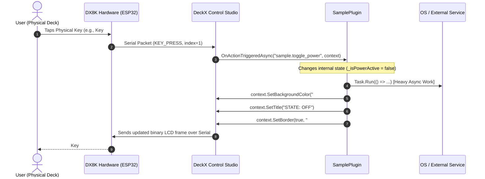
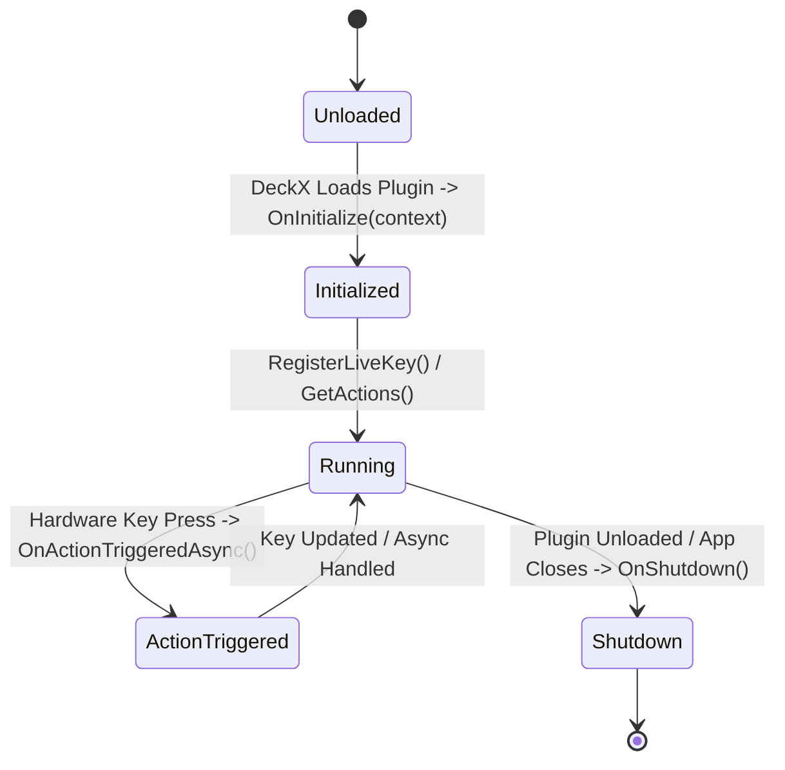

# DeckX Button Plugin Architecture & Developer Deep Dive

> **Target Platform:** DeckX Control Studio (.NET 8 / Avalonia UI / ESP32 Hardware Deck)  
> **Package / Library:** `DeckX.Core` (v1.1.1+)  
> **Template:** `DeckX.Plugin.SampleTemplate`  
> **Target Device:** DX8K (8-Key Physical Macro Deck with LCD & Rotary Encoders)

---

## 📑 Table of Contents
1. [Overview & Architectural Philosophy](#1-overview--architectural-philosophy)
2. [High-Level Architecture & Communication Flow](#2-high-level-architecture--communication-flow)
3. [Project Structure Anatomy](#3-project-structure-anatomy)
4. [Deep Dive: Project Configuration & Auto-Packaging (`.csproj`)](#4-deep-dive-project-configuration--auto-packaging-csproj)
5. [Deep Dive: The Manifest File (`plugin.json`)](#5-deep-dive-the-manifest-file-pluginjson)
6. [Deep Dive: Plugin Implementation (`SamplePlugin.cs`)](#6-deep-dive-plugin-implementation-sampleplugincs)
   - [Interface Contract (`IDeckXPlugin`)](#interface-contract-ideckxplugin)
   - [Vector SVG Icon System](#vector-svg-icon-system)
   - [Plugin Lifecycle](#plugin-lifecycle)
   - [Action Execution & Asynchronous Non-Blocking Flow](#action-execution--asynchronous-non-blocking-flow)
   - [Two-Way State Synchronization & Multi-Key Updates](#two-way-state-synchronization--multi-key-updates)
   - [The 8 Sample Reference Implementations](#the-8-sample-reference-implementations)
7. [Hardware LCD Rendering API (`DeckKeyActionContext`)](#7-hardware-lcd-rendering-api-deckkeyactioncontext)
8. [Critical Performance Rules](#8-critical-performance-rules)
   - [Rule 1: Never Block the UI Thread](#rule-1-never-block-the-ui-thread)
   - [Rule 2: Serial Flooding Prevention & Render Cache](#rule-2-serial-flooding-prevention--render-cache)
9. [Step-by-Step: Building Your Own Custom Plugin](#9-step-by-step-building-your-own-custom-plugin)
10. [Troubleshooting & Verification](#10-troubleshooting--verification)

---

## 1. Overview & Architectural Philosophy

The **DeckX Control Studio** is a modular desktop application designed to communicate with external hardware decks (such as the DX8K, powered by ESP32 microcontrollers). 

Plugins in DeckX are **dynamically loaded .NET 8 assemblies** that allow third-party developers to extend the deck's capabilities. A button plugin can:
- Listen for physical key presses from the hardware deck.
- Execute desktop automations, trigger macros, or call external REST/WebSocket APIs.
- Dynamically alter physical key visuals (titles, colors, icons, borders) in real time.
- Display live PC telemetry (CPU/GPU stats, clocks, notifications, media metadata).

```
   ┌────────────────────────────────────────────────────────┐
   │                  PHYSICAL DX8K DECK                    │
   │  ┌───────┐  ┌───────┐  ┌───────┐  ┌───────┐            │
   │  │ KEY 1 │  │ KEY 2 │  │ KEY 3 │  │ KEY 4 │  (LCD/TFT) │
   │  └───────┘  └───────┘  └───────┘  └───────┘            │
   │  ┌───────┐  ┌───────┐  ┌───────┐  ┌───────┐            │
   │  │ KEY 5 │  │ KEY 6 │  │ KEY 7 │  │ KEY 8 │            │
   │  └───────┘  └───────┘  └───────┘  └───────┘            │
   └───────────────────────────▲────────────────────────────┘
                               │ USB Serial Packet Stream
                               │ (Hardware Key Events & LCD Frame Buffers)
   ┌───────────────────────────▼────────────────────────────┐
   │                 DECKX CONTROL STUDIO                   │
   │               (Host Application / Core)                │
   │                                                        │
   │   ┌────────────────────────────────────────────────┐   │
   │   │               Plugin Loader Host               │   │
   │   └───────────────────────▲────────────────────────┘   │
   └───────────────────────────┼────────────────────────────┘
                               │ In-Process Assembly Boundary
   ┌───────────────────────────▼────────────────────────────┐
   │             DeckX.Plugin.SampleTemplate                │
   │            (Your Custom Plugin Assembly)               │
   │                                                        │
   │  • OnInitialize()          • OnActionTriggeredAsync()  │
   │  • Render State Cache      • Background Task Workers   │
   │  • Two-way Live Keys       • OnShutdown()              │
   └────────────────────────────────────────────────────────┘
```

---

## 2. High-Level Architecture & Communication Flow

When an action occurs, the communication traverses several layers:



---

## 3. Project Structure Anatomy

```
DeckX.Plugin.SampleTemplate/
│
├── DeckX.Plugin.SampleTemplate.csproj   # MSBuild SDK project with integrated auto-packer
├── plugin.json                          # Plugin manifest, action declarations, and default layout
├── SamplePlugin.cs                      # Core C# logic implementing IDeckXPlugin
├── README.md                            # Quick-start summary
├── DEVELOPER_GUIDE.md                   # This deep-dive architecture document
├── DeckX_Plugin_Developer_Guide.pdf     # Graphical reference guide
└── assets/                              # (Optional) External assets, images, or bundled dependencies
```

---

## 4. Deep Dive: Project Configuration & Auto-Packaging (`.csproj`)

The project file uses the **Microsoft.NET.Sdk** targeting `.net8.0`:

```xml
<Project Sdk="Microsoft.NET.Sdk">
  <PropertyGroup>
    <TargetFramework>net8.0</TargetFramework>
    <ImplicitUsings>enable</ImplicitUsings>
    <Nullable>enable</Nullable>
    <CopyLocalLockFileAssemblies>true</CopyLocalLockFileAssemblies>
  </PropertyGroup>

  <!-- Dual-Resolution: References project in solution if present, or official NuGet package -->
  <ItemGroup Condition="Exists('..\..\DeckX.Core\DeckX.Core.csproj')">
    <ProjectReference Include="..\..\DeckX.Core\DeckX.Core.csproj">
      <Private>false</Private>
      <ExcludeAssets>runtime</ExcludeAssets>
      <PrivateAssets>all</PrivateAssets>
    </ProjectReference>
  </ItemGroup>

  <ItemGroup Condition="!Exists('..\..\DeckX.Core\DeckX.Core.csproj')">
    <PackageReference Include="DeckX.Core" Version="1.1.1">
      <PrivateAssets>all</PrivateAssets>
      <ExcludeAssets>runtime</ExcludeAssets>
    </PackageReference>
  </ItemGroup>
```

### Why `<ExcludeAssets>runtime</ExcludeAssets>`?
`DeckX.Core.dll` is already loaded in memory by the host application (DeckX Control Studio). If your plugin bundles a duplicate copy of `DeckX.Core.dll` in its zip package, the .NET CLR assembly loader will encounter type mismatch collisions or `FileLoadException`. Therefore, `DeckX.Core` is strictly marked as a compile-time reference.

### Integrated Auto-Packer (`AutoPackageDeckXPlugin`)
The `.csproj` contains a custom MSBuild Target that triggers automatically after `dotnet build` or pressing Build in Visual Studio:
1. **Creates a clean staging directory** (`bin\staging\`).
2. **Copies** `plugin.json`, the compiled plugin `.dll`, and debug `.pdb`.
3. **Zips** the staging directory into a distribution package with the `.deckxplugin` extension:
   ```
   releases/DeckX.Plugin.SampleTemplate.deckxplugin
   ```
4. **Installs for Live Testing:** It copies the plugin directly into:
   ```
   %APPDATA%\DeckX\Plugins\com.deckx.sampletemplate\
   ```
   This means whenever you compile in your IDE, the latest version of your plugin is immediately ready for DeckX Control Studio without manual copying.

---

## 5. Deep Dive: The Manifest File (`plugin.json`)

The manifest file is the entry point that DeckX Control Studio parses to register the plugin before loading any C# assembly.

```json
{
  "id": "com.deckx.sampletemplate",
  "name": "DeckX Button Plugin Template",
  "version": "1.0.0",
  "author": "DeckX Developer",
  "description": "Sample reference template for creating custom C# button plugins...",
  "category": "Sample Template (Plugin)",
  "targetDevice": "DX8K",
  "supportedDevices": [ "DX8K" ],
  "assembly": "DeckX.Plugin.SampleTemplate.dll",
  "actions": [ ... ],
  "defaultPage": { ... }
}
```

### Key Properties:
- **`id`**: Unique reverse-DNS identifier (e.g., `com.mycompany.myplugin`). Must match `IDeckXPlugin.Id`.
- **`assembly`**: The filename of the `.dll` produced by the C# compiler.
- **`targetDevice`**: Hardware model targeted (`DX8K` for 8-key decks).
- **`actions`**: The catalog of action buttons that appear in the DeckX Control Studio left sidebar for drag-and-drop customization.
- **`defaultPage`**: Defines an out-of-the-box 8-key page layout created automatically when a user imports your `.deckxplugin`.

#### Custom Borders & Modern Styling in `defaultPage`:
```json
{
  "index": 1,
  "title": "STATE: ON",
  "actionType": "Plugin: Power Toggle",
  "pluginActionId": "sample.toggle_power",
  "pluginId": "com.deckx.sampletemplate",
  "hasAction": true,
  "showTitle": true,
  "iconSize": 50,
  "useCustomColor": true,
  "customColorHex": "#10B981",
  "hasCustomBorder": true,
  "customBorderColorHex": "#FFFFFF",
  "customBorderWidth": 1.5
}
```

---

## 6. Deep Dive: Plugin Implementation (`SamplePlugin.cs`)

### Interface Contract (`IDeckXPlugin`)
Every button plugin must implement `IDeckXPlugin` from `DeckX.Core.Plugins`:

```csharp
public interface IDeckXPlugin
{
    string Id { get; }
    string Name { get; }
    string Description { get; }
    string Version { get; }
    string Author { get; }
    string Category { get; }
    string CategoryIconGeometry { get; }
    string? IconGeometry { get; }

    void OnInitialize(IDeckXPluginContext context);
    IEnumerable<ActionItemModel> GetActions();
    Task OnActionTriggeredAsync(string actionId, DeckKeyActionContext context);
    void OnShutdown();
}
```

---

### Vector SVG Icon System
DeckX uses standard SVG path data strings (`M... Z`) rather than rasterized PNG/BMP files. This ensures icons render crisply at any resolution, scale, and color on both the PC monitor and the deck's LCD:

```csharp
private const string PowerIcon = "M13 3h-2v10h2V3zm4.83 2.17l-1.42 1.42A6.92 6.92 0 0 1 19 12...";
```
> **Tip:** You can grab geometry strings from Lucide Icons, Material Design Icons, or Feather Icons SVG paths.

---

### Plugin Lifecycle



1. **`OnInitialize(IDeckXPluginContext context)`**:
   Called once upon plugin load. Store the `_context` reference and register live key handlers.
2. **`GetActions()`**:
   Supplies the catalog of actions shown in the UI sidebar.
3. **`OnActionTriggeredAsync(string actionId, DeckKeyActionContext context)`**:
   Executed whenever a user taps a hardware key or clicks the software preview button.
4. **`OnShutdown()`**:
   Called when the plugin is disabled or DeckX closes. Unregister live keys and clear memory caches.

---

### Action Execution & Asynchronous Non-Blocking Flow

When a user taps a key, DeckX calls:
```csharp
public async Task OnActionTriggeredAsync(string actionId, DeckKeyActionContext context)
```

> [!WARNING]
> The host calling thread must **NEVER** be blocked with synchronous calls like `Thread.Sleep()`, synchronous `HttpClient.Get()`, or `Process.WaitForExit()`. Doing so will freeze the entire Avalonia UI and introduce hardware latency.

**Correct Pattern for Long-Running Operations:**
```csharp
case "sample.open_url":
    _ = Task.Run(() =>
    {
        try
        {
            Process.Start(new ProcessStartInfo
            {
                FileName = "https://github.com",
                UseShellExecute = true
            });
        }
        catch (Exception ex)
        {
            Debug.WriteLine($"[Plugin] Error: {ex.Message}");
        }
    });
    context.ShowAlert("Opening Browser...");
    break;
```

---

### Two-Way State Synchronization & Multi-Key Updates

What if pressing **Key #1** needs to update **Key #1** AND also update a status display on **Key #8**?

In `SamplePlugin`, this is achieved using `_context.TriggerKeyUpdate(...)`:
```csharp
case "sample.toggle_power":
    _isPowerActive = !_isPowerActive;
    
    // 1. Update the button that was pressed:
    UpdatePowerKey(context);
    
    // 2. Broadcast updates to any OTHER button on the page bound to this action:
    _context?.TriggerKeyUpdate("sample.toggle_power", UpdatePowerKey);
    
    // 3. Atomically update the Status Badge button (Key #8):
    _context?.TriggerKeyUpdate("sample.status_badge", UpdateStatusKey);
    break;
```

---

### The 8 Sample Reference Implementations

The template includes 8 distinct buttons demonstrating essential patterns:

| Action ID | Action Title | Pattern Demonstrated |
| :--- | :--- | :--- |
| `sample.toggle_power` | **Power Toggle** | Dynamic ON/OFF state with real-time background color swapping (`#10B981` Emerald ↔ `#EF4444` Crimson) and white border sync. |
| `sample.live_counter` | **Tap Counter** | High-frequency tap registration with immediate numeric LCD title update (`CLICKS: N`). |
| `sample.color_cycle` | **Color Cycler** | Iterating through an array of brand hex colors on each hardware tap. |
| `sample.live_clock` | **Live Clock Ticker** | Telemetry listener receiving 1-second ticks without user interaction (`DateTime.Now:HH:mm:ss`). |
| `sample.open_url` | **Open Web Link** | Asynchronous, non-blocking process launcher with toast feedback (`context.ShowAlert`). |
| `sample.hotkey_macro` | **Hotkey Macro** | Automation trigger demonstration without UI thread contention. |
| `sample.reset_state` | **Reset All** | Multi-key atomic reset using `TriggerKeyUpdate` across multiple action targets. |
| `sample.status_badge` | **Status Badge** | Passive telemetry indicator responding to system state changes. |

---

## 7. Hardware LCD Rendering API (`DeckKeyActionContext`)

The `DeckKeyActionContext` object passed into action triggers and live key delegates provides direct control over the button's visual representation:

```csharp
// Change button title text
ctx.SetTitle("LIVE STATUS");

// Change title text color (HEX)
ctx.SetTitleColor("#00FF66");

// Change button background color (HEX)
ctx.SetBackgroundColor("#1E293B");

// Set or update custom button border (enabled, hexColor, thickness)
ctx.SetBorder(true, "#FFFFFF", 1.5);

// Set SVG vector icon
ctx.SetIcon(PowerIconSvgString);

// Adjust icon scale (e.g., 50.0)
ctx.SetIconSize(50.0);

// Show a native toast alert on the desktop screen
ctx.ShowAlert("State changed successfully!");
```

---

## 8. Critical Performance Rules

### Rule 1: Never Block the UI Thread
Always offload disk I/O, database calls, network requests, and external process spawning to `Task.Run()` or `async/await`.

### Rule 2: Serial Flooding Prevention & Render Cache
The DX8K connects via USB Serial (typically 115200 or higher baud rate). If your plugin fires 60 visual updates per second when the values haven't changed, the USB serial buffer will choke, leading to hardware latency and dropped packets.

`SamplePlugin.cs` implements a **State Fingerprint Render Cache**:
```csharp
private readonly ConcurrentDictionary<int, string> _renderCache = new();

private void UpdatePowerKey(DeckKeyActionContext ctx)
{
    string expectedTitle = _isPowerActive ? "STATE: ON" : "STATE: OFF";
    string fingerprint = $"power_{_isPowerActive}";

    // If the button index already has this state and title, SKIP REDRAW!
    if (_renderCache.TryGetValue(ctx.KeyIndex, out var last) 
        && last == fingerprint 
        && ctx.CurrentTitle == expectedTitle)
    {
        return;
    }

    _renderCache[ctx.KeyIndex] = fingerprint;

    // Apply visual updates only when state actually changed:
    ctx.SetTitle(expectedTitle);
    ctx.SetBackgroundColor(_isPowerActive ? "#10B981" : "#EF4444");
    ctx.SetBorder(true, "#FFFFFF", 1.5);
    ctx.SetIcon(PowerIcon);
}
```

---

## 9. Step-by-Step: Building Your Own Custom Plugin

### Step 1: Copy and Rename the Project
1. Copy the `DeckX.Plugin.SampleTemplate` directory to `DeckX.Plugin.MyFeature`.
2. Rename `DeckX.Plugin.SampleTemplate.csproj` to `DeckX.Plugin.MyFeature.csproj`.

### Step 2: Configure `plugin.json`
Update:
- `"id"`: `"com.myusername.myfeature"`
- `"name"`: `"My Custom Feature"`
- `"assembly"`: `"DeckX.Plugin.MyFeature.dll"`
- Define your custom actions under `"actions"`.

### Step 3: Implement Your Actions in C#
1. Rename the class to `MyFeaturePlugin` and assign your metadata properties:
   ```csharp
   public string Id => "com.myusername.myfeature";
   public string Name => "My Custom Feature";
   ```
2. Implement your business logic in `OnActionTriggeredAsync`:
   ```csharp
   public async Task OnActionTriggeredAsync(string actionId, DeckKeyActionContext context)
   {
       if (actionId == "myfeature.mute_mic")
       {
           await ToggleMicrophoneMuteAsync();
           context.SetBackgroundColor("#EF4444");
           context.SetTitle("MUTED");
       }
   }
   ```

### Step 4: Build and Deploy
Run in your terminal:
```bash
dotnet build -c Release
```
Your package is automatically compiled and packaged into:
```
releases/DeckX.Plugin.MyFeature.deckxplugin
```
And copied to `%APPDATA%\DeckX\Plugins\com.myusername.myfeature\` for instant use in DeckX Control Studio!

---

## 10. Troubleshooting & Verification

| Issue | Cause | Solution |
| :--- | :--- | :--- |
| **Plugin does not appear in DeckX sidebar** | Manifest ID mismatch or invalid JSON. | Verify `plugin.json` has valid syntax and the `"assembly"` field matches the compiled `.dll` name. |
| **`TypeLoadException` or `FileLoadException` on launch** | `DeckX.Core.dll` was packaged into the `.deckxplugin` zip. | Ensure `<Private>false</Private>` and `<ExcludeAssets>runtime</ExcludeAssets>` are set on the `DeckX.Core` reference. |
| **Key updates lag or feel sluggish** | Redundant redraws or blocking synchronous calls. | Verify `Task.Run` is used for I/O and verify that `_renderCache` is bypassing identical frames. |
| **Icons look blurry or distorted** | Using raster PNG instead of SVG path. | Use standard vector geometry strings in `SetIcon(svgPath)` and specify `SetIconSize(50.0)`. |
